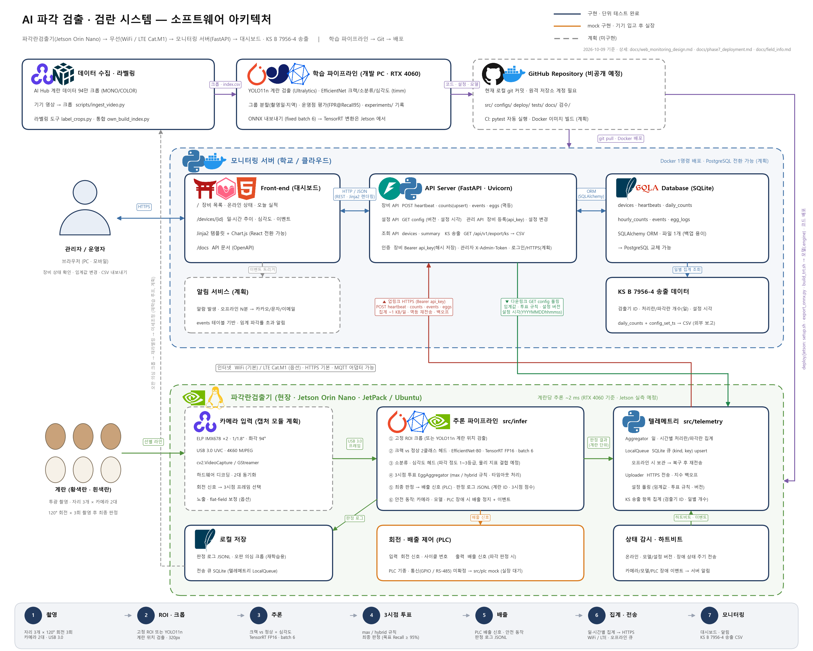

# AI 기반 파각 검출 및 검란 시스템 (이데아아이㈜ 산학 프로젝트)

계란 선별기 영상으로 **파각란(크랙)을 실시간 검출·배출**하고, 투광 영상으로 **종란 검란**(백신용 유정란 선별)을 하는 시스템입니다.
구성: 학습 파이프라인(PC) → 엣지 추론(Jetson Orin Nano, 카메라 2대, 3시점 투표) → PLC 배출 → 무선 모니터링 웹서비스(FastAPI, KS B 7956-4 송출).



## 먼저 읽을 문서
1. [docs/final_summary.md](docs/final_summary.md) — 지금까지의 결론·수치·한계 (AI Hub 데이터 기준)
2. [docs/field_info.md](docs/field_info.md) — 현장 조건(카메라·Jetson·KS 기준·일정), 기업 답변 정리
3. [docs/TODO.md](docs/TODO.md) — 완료/남은 일, 기업 결정 대기 항목
4. [docs/web_monitoring_design.md](docs/web_monitoring_design.md), [docs/webmon_howto.md](docs/webmon_howto.md) — 모니터링 웹서비스 설계·실행법
5. [docs/labeling_guide.md](docs/labeling_guide.md) — 자사 영상 라벨링 규칙 (팀원 작업)
6. [CLAUDE.md](CLAUDE.md) — 프로젝트 전체 컨텍스트와 설계 원칙, 진행 현황 요약

## 시작하기

```powershell
git clone <저장소 URL>
cd <폴더>
python -m venv .venv ; .\.venv\Scripts\Activate.ps1        # Python 3.10 권장
python -m pip install -r requirements.txt
# GPU: torch 2.6.0+cu124 (드라이버가 CUDA 12.x 를 지원해야 함)  https://pytorch.org/get-started/locally/
python -m pytest -q                                         # 단위 테스트 76개
```

경로에 한글·공백이 길면 Windows 260자 제한에 걸릴 수 있습니다. `C:\egg` 처럼 짧은 경로에 클론하는 것을 권장합니다.

## 저장소에 없는 것 (별도 전달)

| 항목 | 위치 규칙 | 받는 곳 |
|---|---|---|
| AI Hub 계란 데이터 (92 GB zip, 내국인 신청) | 원본 zip 은 아무 곳, 라벨 xml 만 `C:\aihub_egg\labels\` (`configs/data.yaml`) | AI Hub 직접 신청 |
| 파생 크롭·분할 (`data/crops/`, `data/splits/`) | `scripts/make_split.py → make_crops.py` 로 재생성 가능 | 팀 공유 드라이브 |
| **기업 제공 영상·사진 (`data/own/`)** | **기업 개발 중 데이터 — 외부 공유 금지, git 에 절대 올리지 않음** | 담당자에게 직접 |
| 학습된 모델 (`*.pt`, `*.onnx`, `*.engine`) | `experiments/<run>/model.pt`, `models/` | 팀 공유 드라이브 |
| 실험 결과 (`experiments/`, `outputs/`) | `experiments/SUMMARY.md` 만 git 에 포함 | 재실행 또는 공유 드라이브 |
| 검수 자료 (`검수/`) | 격자 이미지·좌표계 확인 등 사람 확인용 | 공유 드라이브 |

`.gitignore` 가 위 폴더와 영상 파일(`*.mkv *.mp4`)을 막고 있습니다. 커밋 전 `git status` 로 데이터 파일이 섞이지 않았는지 확인해 주세요.

## 디렉터리

```
configs/        모든 설정 (data.yaml 경로·좌표계, exp_*.yaml 실험, infer.yaml 판정·투표, video_ingest.yaml, queue_*.yaml)
src/common/     config.py            YAML 로더
src/datasets/   aihub_xml.py coords.py split.py audit.py crops.py   AI Hub 파서·좌표계·그룹 분할·감사·크롭
                video_ingest.py      기기 영상 → 카메라 화면 분리 → ROI → 정지 구간 → 크롭
                roboflow_yolo.py fake_aihub.py   보조 데이터, 테스트용 합성 데이터
src/train/      classifier.py        크롭 분류기 학습·평가 (운영점, 축별 지표, label_map, epochs=0 평가 전용)
src/models/     patchcore.py         이상탐지 (실험 결과 제외됨)
src/eval/       metrics.py tracker.py   소분류별 P/R·운영점, experiments/ 기록
src/infer/      pipeline.py adapters.py   2단계 추론 (YOLO 검출 → 크롭 분류), ONNX/TensorRT 어댑터
                voting.py            3시점 투표 규칙, EggAggregator (타임아웃)
src/plc/        base.py mock.py      PLC 인터페이스 + mock (기종 확정 후 실장)
src/telemetry/  uploader.py          장비 → 서버 집계 전송 (오프라인 큐, 백오프, 설정 폴링)
src/webmon/     app.py db.py schemas.py templates/   모니터링 서버 (FastAPI + SQLite, 대시보드, KS 송출 CSV)
deploy/jetson/  README, export_onnx.py, setup.sh, build_trt.sh, bench_jetson.py
scripts/        make_split.py → make_crops.py → export_det.py      데이터 준비
                train_det.py train_cls.py run_queue.py               학습 (GPU 작업은 큐 하나로만)
                ingest_video.py label_crops.py own_build_index.py    자사 영상 → 크롭 → 라벨링 → 인덱스
                simulate_device.py                                   가상 장비로 웹서비스 데모
                collect_results.py ablation_table.py reject_policy.py demo_infer.py   분석·데모
                draw_architecture.py                                 구조도 다시 그리기
docs/           설계·결과 문서 (위 "먼저 읽을 문서")
tests/          단위 테스트 (python -m pytest)
```

## 자주 쓰는 명령

```powershell
# 모니터링 웹서비스 (http://127.0.0.1:8000/, API 문서 /docs)
python -m uvicorn src.webmon.app:app --host 127.0.0.1 --port 8000
python scripts\simulate_device.py --server http://127.0.0.1:8000     # 가상 장비 데모

# 기업 영상 → 크롭 → 라벨링 → 인덱스
python scripts\ingest_video.py "data\own\videos\<영상>.mkv"
python scripts\label_crops.py data\own\frames\<영상>                    # 키: n 정상 c 크랙 u 모름, 1/2/3 심각도, w/b 난각색, s 도장
python scripts\own_build_index.py

# 학습·평가 (RTX 4060 8GB 기준, DataLoader workers 는 4 이하)
python scripts\train_cls.py --config exp_cls_mono_crackbin
python scripts\run_queue.py configs\queue_all.yaml
python scripts\collect_results.py
```

## 규칙
- 설정값은 `configs/*.yaml` 에만 둔다 (코드 하드코딩 금지).
- 추론·PLC·웹·텔레메트리 모듈은 단위 테스트를 함께 올린다.
- 실험은 `experiments/` 에 config·seed·git hash·지표가 기록되어야 결과로 인정한다.
- 기업 제공 자료(영상·사진·도면)는 저장소·외부 서비스에 올리지 않는다. 이 저장소는 비공개로 유지한다.
